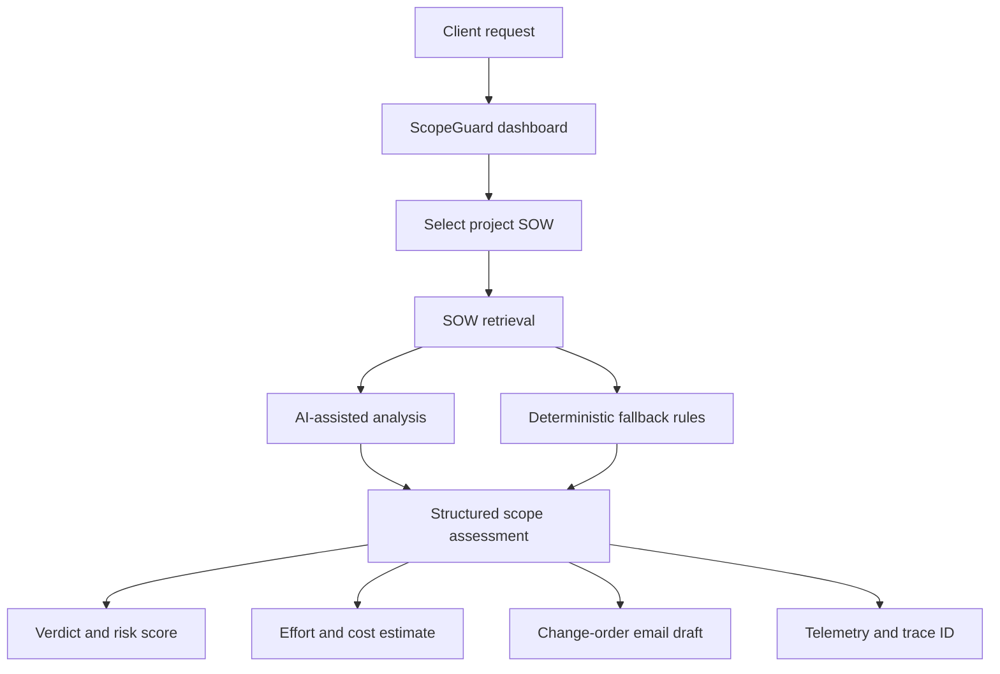

<div align="center">
  <h1>ScopeGuard</h1>
  <p><strong>AI-assisted scope control for software projects.</strong></p>
  <p>Turn ambiguous client requests into structured scope-risk reviews, impact estimates, and clearer change-order conversations.</p>
  <p>
    
    
    
    
  </p>
</div>

---

ScopeGuard is a project-scope auditing prototype for software teams, freelancers, and delivery leads. It compares a new client request against a project's Statement of Work (SOW) and produces a structured assessment that can help a team decide whether a request appears in scope, ambiguous, or likely to require a change order.

> **Project status:** AI-assisted decision support, not legal advice or an automated contract interpretation system. Review the source SOW, assumptions, estimates, and generated client communications before using them in a real engagement.

## What it does

- **SOW-aware review** — evaluates client requests against project-specific deliverables, exclusions, and change-order clauses.
- **Scope verdicts** — returns `IN_SCOPE`, `AMBIGUOUS_TRAP`, or `OUT_OF_SCOPE_CREEP`.
- **Impact breakdown** — provides a risk score, estimated additional hours, revenue-at-risk estimate, and line items.
- **Change-order draft** — generates a client-facing email draft to help clarify and document requested changes.
- **Scenario presets** — try representative examples, including an administrative portal request, payment integration work, and a small visual adjustment.
- **Model telemetry** — surfaces model name, latency, token counts, estimated API cost, and trace ID when returned by the application.
- **Fallback analysis** — includes deterministic handling for selected request patterns when the model-backed path is unavailable or unsuitable.
- **SOW retrieval** — supports project SOW records and a local fallback mode.

## How it works



The analysis is intended to support human review. The estimated effort and cost are illustrative outputs based on the configured project data and analysis logic; they are not guarantees or contractual quotes.

## Tech stack

| Layer | Technology |
|---|---|
| Web application | Next.js App Router, React, TypeScript |
| AI workflow | Mastra, Vercel AI SDK, OpenAI-compatible provider |
| Validation | Zod |
| SOW storage | MongoDB with local fallback support |
| Error monitoring | Sentry for Next.js |

## Getting started

### Prerequisites

- Node.js compatible with the Next.js version in `package.json`
- npm (or another compatible Node package manager)
- An AI provider key for the model-backed analysis path
- MongoDB configuration if you want to use remote SOW storage

### Install and run

```bash
git clone https://github.com/kishorekrrish3/ScopeGuard.git
cd ScopeGuard
npm install
```

Create a local `.env.local` file using the variable names expected by the project configuration. Keep API keys and database credentials out of Git.

```bash
npm run dev
```

Open [http://localhost:3000](http://localhost:3000).

### Available scripts

```bash
npm run dev
npm run build
npm run start
npm run lint
```

## Example review workflow

1. Choose a project and its SOW.
2. Enter the new client request or select a scenario preset.
3. Run the scope audit.
4. Review the verdict, cited clause, reasoning, effort estimate, and line items.
5. Edit and approve any change-order communication before sending it.

## Repository layout

```text
src/
├── app/          # Dashboard and API routes
├── lib/           # SOW contracts and data access
└── mastra/        # Agent and tool definitions
```

## Responsible use

- Treat generated verdicts, risk scores, hours, and dollar estimates as suggestions to review—not authoritative determinations.
- Confirm that the correct SOW version, currency, rates, and clauses are configured for each project.
- Do not submit confidential client material unless you are authorized to process it with the configured provider and storage system.
- Keep credentials in environment variables and use least-privilege access for any connected database or AI provider.
- ScopeGuard is not a substitute for legal, commercial, or project-management judgment.

## Roadmap

- Add a richer test suite for ambiguous and adversarial requests.
- Improve traceable links from each finding to the exact SOW clause.
- Add exportable review reports and an approval history.
- Expand configuration and documentation for provider and storage modes.

## Contributing

Issues and pull requests are welcome. Please include reproducible steps for bugs and clearly label assumptions in proposed scope-analysis rules.

---

Built as an exploration of AI-assisted project governance and scope management.
